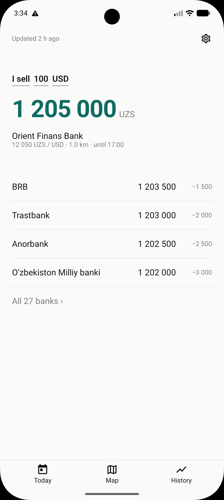
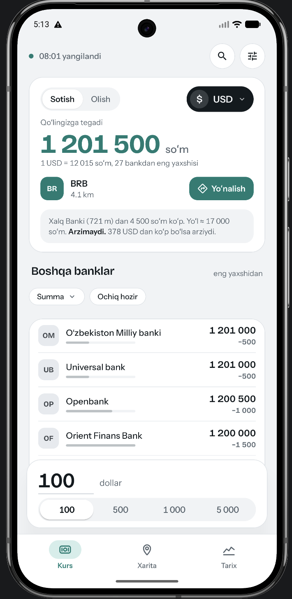
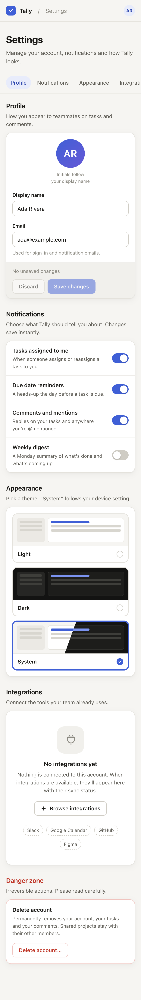
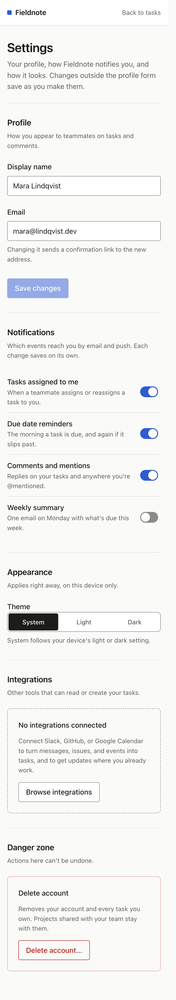
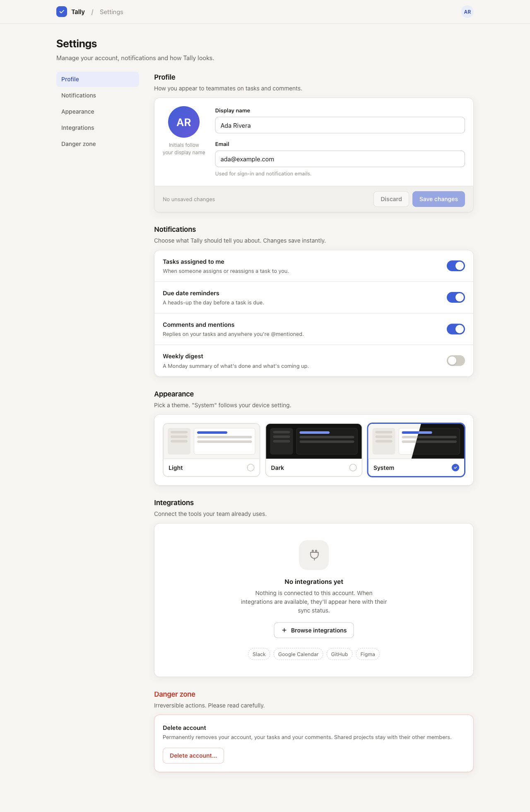
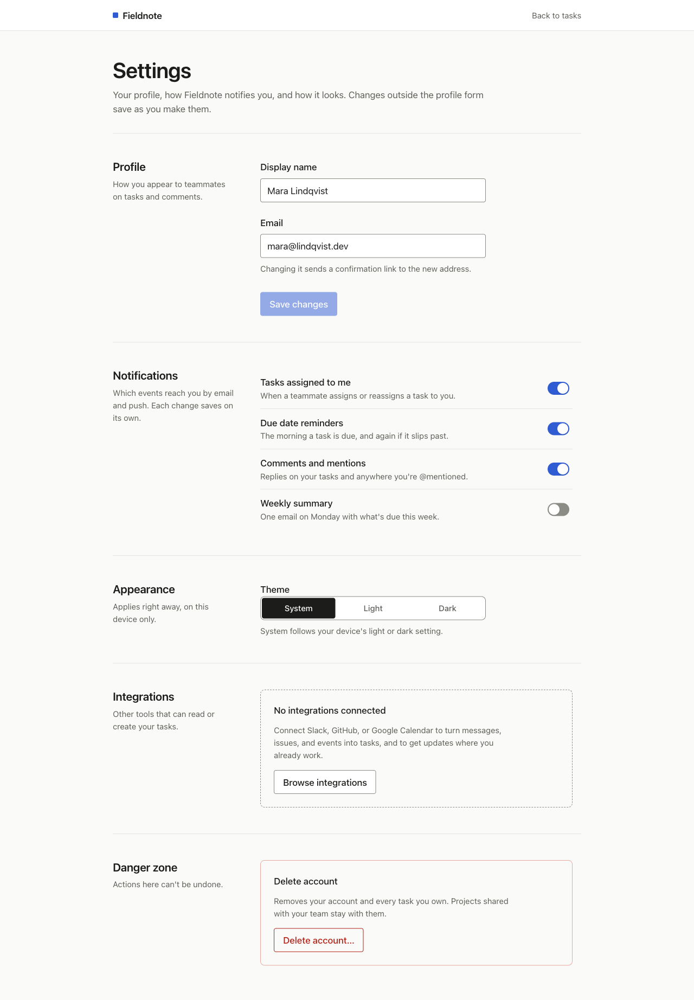

# design-taste

An agent skill that makes the agent ask what a screen is for before it touches a token. It starts from the user's question, builds the one object that answers it, reviews from five chairs, and only then applies the floor: tokens, states, targets, contrast. Aimed at generic generated UI and at screens that show data without answering anything.

The guidance is **inspired by** public work from 24 designers. It was written by an AI and is **not endorsed by any of them**. Each entry is marked **Checked** or **Partial** according to what the designer's own page supported. See [NOTICE.md](NOTICE.md).

## The difference it is for

A real redesign, done with the same references the skill is built from. Same data, same screen. Before answered "what will I get, and where?" in grey text. After answers it with one object, does the user's arithmetic, and gives one action.

| Before | After |
|:---:|:---:|
|  |  |

Four screens, the five-chair critique, and the vocabulary rules that removed the inconsistencies are in [`examples/kurs/`](examples/kurs/). The principles they demonstrate are in [`references/vision.md`](skills/design-taste/references/vision.md).

## The vision test, with and without the skill

Same data, same model, prompt withholds the user's question. Both agents found it. The skill run has one action, a decision sentence with its threshold and assumption, comparisons as "N less" with bars, and no overflow. The no-skill run has no action on screen and is 80px wider than the phone. Scores for all four runs, including where the skill run slipped, are in [`examples/rates-screen/`](examples/rates-screen/).

| Without skill | With skill |
|:---:|:---:|
|  |  |

## The floor, with and without the skill

Same prompt, same model. The left agent had no skill. The right agent read `SKILL.md` (0.3.0, before the vision layer). Nothing was edited afterwards. A settings page has no question to answer, so this shows only the floor.

| Without skill | With skill |
|:---:|:---:|
|  |  |

| Without skill, 1280 wide | With skill, 1280 wide |
|:---:|:---:|
|  |  |

Both pages are competent. The skill's version is quieter, uses one token scale, and was verified by rendering. It also has an 18px horizontal overflow on phones that the agent's own check missed; it is kept as generated and documented. Prompt, source files, and the full diff table are in [`examples/settings-page/`](examples/settings-page/).

## What's inside

```
design-taste/
  skills/design-taste/SKILL.md          entry point: the three sentences, modes, core rules, quick reference
  skills/design-taste/references/
    vision.md                           the question, the answer object, five chairs, one vocabulary, say no (Q1–Q10)
    philosophy.md                       one entry per designer, with status and a problem → entry table
    anti-slop-checklist.md              observable checks for review, including mobile and responsive
    tokens.md                           starter CSS tokens (spacing, type, color, motion, touch, a11y) + Tailwind map
    sources.md                          links, what each page showed, and removed entries
  tests/                                fixtures, expected results, and how to re-run the with/without tests
  examples/kurs/                        the real before/after redesign the vision layer is built from
  examples/rates-screen/                the vision test: four runs scored item by item
  examples/settings-page/               the floor test: with/without pages, captures, compare.html
  .claude-plugin/                       plugin and marketplace manifests
  scripts/install.sh                    copy-install script
  NOTICE.md                             not-endorsed statement and removal policy
  CHANGELOG.md
  LICENSE                               MIT
```

## Install

### Option 1: Claude Code plugin (recommended, supports updates)

In Claude Code:

```
/plugin marketplace add zokirjonkodirov/design-taste
/plugin install design-taste@design-taste
```

Update later with:

```
/plugin marketplace update design-taste
/plugin update design-taste
```

Restart Claude Code after updating.

### Option 2: Install script

```bash
git clone https://github.com/zokirjonkodirov/design-taste.git
cd design-taste
bash scripts/install.sh              # user-level: ~/.claude/skills/
bash scripts/install.sh --project    # project-level: ./.claude/skills/
```

To update, run `git pull` and re-run the script.

## Use

Every mode starts with three sentences: the user's question, the answer object, the one action.

- **Review:** opens with "What this screen is for" and five-chair findings, then the checklist. Findings come back as `file:line · severity · principle · fix`, Blocking first, and end with what should be removed.
- **Suggest:** 2–3 directions that answer the question differently, each with its principle and what it loses.
- **Implement:** the answer object first, then evidence, comparisons in the user's unit, one action in thumb reach, then the floor; verified at 320, 375, and 1280px.

If the project has its own design system, the project wins on conflicts.

## Who is in it

| Area | Designers |
|---|---|
| Restraint and utility | Rams, Maeda, Reichenstein, Butterick, Case |
| Structure and system | Vinh, Spiekermann, Frost, Shadeed |
| Usability and access | Nielsen, Norman, Yablonski, Pickering |
| Mobile and responsive | Wroblewski, Clark, Marcotte |
| Craft and feedback | Kowalski, Freiberg, Comeau, Taylor |
| Character | Chimero, van Schneider, Appleton, Allen |

20 of 24 entries are **Checked** against the designer's own text. Removed entries and the reason for each are listed in `sources.md`.

## Reliability

- Only **Checked** entries are cited by name in reviews. **Partial** entries are prompts, not positions.
- The skill is tested by running the same task with and without it and comparing (see `tests/`). Each release records the result in `CHANGELOG.md`.
- Dead or redirected sources are listed in `sources.md` rather than hidden.

## Contributing

Pull requests welcome, especially:

- Corrections, with a link to the designer's own page or statement. A correction that cites the source can raise an entry to **Checked**.
- Observable checklist items (something you can see in code or on screen).
- Token sets for other stacks (native iOS and Android).

Keep entries as paraphrases, and keep each principle tied to a review question.

## Removal

Any named designer can ask for their entry to be removed or corrected. See [NOTICE.md](NOTICE.md).

## License

MIT. See [LICENSE](LICENSE). The designers' own work is not covered by this license.
