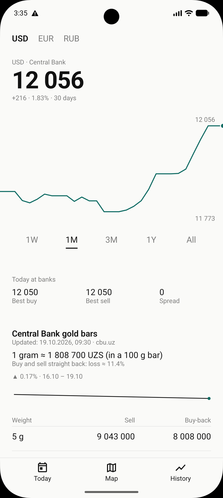
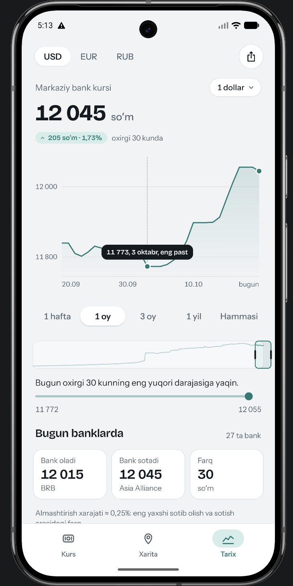
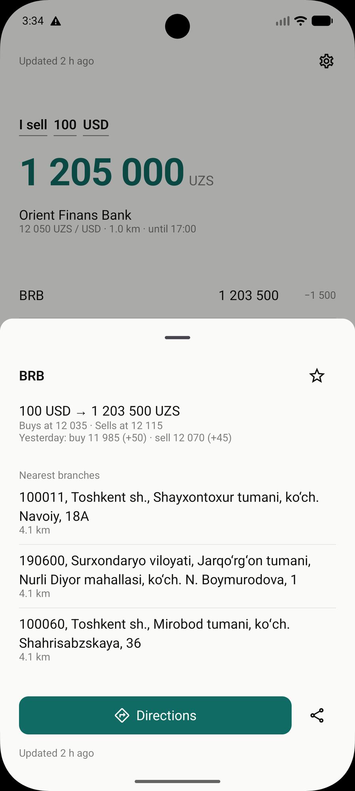
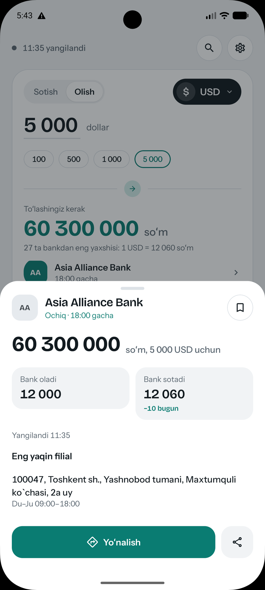
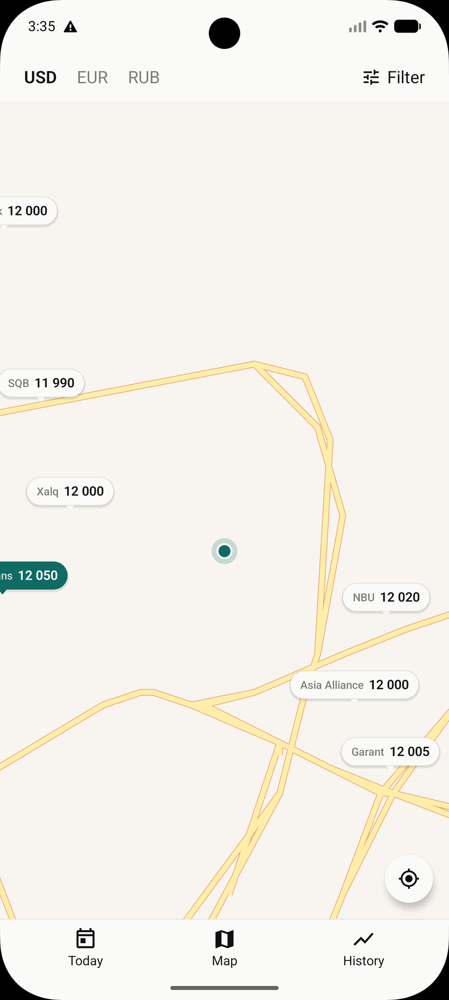
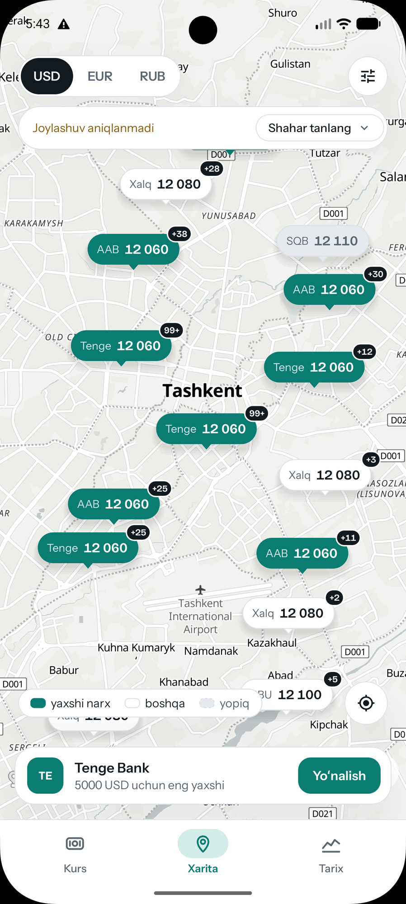

# Example: Kurs, a currency app for Uzbekistan

The app answers one question: **what will I get for my dollars, and where?** The first build answered it in grey text. The redesign answers it with one object you can read from across the room, and treats every other number as a comparison against it. Same data, same four screens.

Screens and critique are from the project owner's redesign of their own app, done with the designers' public work as the reference set. Every principle in `references/vision.md` has its instance here. The "after" screens are the shipped app: Today and History from the current build, bank tray and map from the round before it.

## Today

| Before | After |
|:---:|:---:|
|  |  |

**Before.** Hero number works. Everything else is a left-aligned text column: the control row is three underlined words, the list is a spreadsheet, 40% of the screen is empty. "What" is teal at 46px; "where" is grey 14px under it. "−1 500" beside "1 203 500" is a subtraction you do in your head.

**After.** One exchange slip: direction, amount, result, best bank, all in one object (Q1). Other banks show the shortfall as a bar and in words, so the list is read at a glance, not parsed (Q2). The screen does the arithmetic: Xalq Banki pays 4 500 more, the trip costs about 17 000, not worth it below 378 USD (Q3). One call to action, Directions, in thumb reach. The amount input with presets sits at the bottom where the thumb is. "Rates at 08:01" with a live dot instead of "updated 2 h ago" (Q9).

## History

| Before | After |
|:---:|:---:|
|  |  |

**Before.** Chart has no scrubber: thirty points and no way to ask what it was on the 2nd. "Spread 0" is a visible data error (best buy equal to best sell cannot both be true). Gold is crammed under the chart with a flat sparkline that says nothing. Nine type sizes, one weight story.

**After.** A scrubbable chart with a crosshair that names the day, marking the low and the latest value and nothing else. The chart says something in words: "today is near the 30-day high". Delta as a chip, not a grey string. Stat tiles carry the bank names. The gold sparkline was replaced by one sentence: sell it straight back and you lose 11.4% (Q6, Q9).

## Bank tray

| Before | After |
|:---:|:---:|
|  |  |

**Before.** Raw address strings with postal codes and region names. Three branches all "4.1 km", and one is in Surxondaryo, about 600 km away. The sheet slides over a dimmed screen that stays sharp. The sheet is the data dump, not a design.

**After.** Today stays visible, blurred and pushed back, so you know where you are and that it no longer responds (Q8). The first line says what you get, the second what you lose against the best. Open state and closing time up front. One nearest branch, with hours, street first (Q7). Tiles always carry two lines so they stay equal height (Q5).

## Map

| Before | After |
|:---:|:---:|
|  |  |

**Before.** Best screen of the four. Pins are legible, the best pin is colored. But labels clip at the edges, roads are default yellow, and there is nowhere to act without leaving the map.

**After.** A peek card at the bottom lets you act without leaving the map. Pins keep an edge margin. This round still has ten teal pins, which breaks Q5: teal no longer says "best". The next round keeps one teal pin, dashes the closed banks, and drops the legend. The example keeps the honest intermediate state.

## What was wrong, from five chairs

The same screens, reviewed as five people (Q4).

**The person standing outside a bank.** One question, buried: "what do I get, and where?" answered in two places and two sizes. Differences in the wrong unit. Addresses nobody can read. "Updated 2 h ago" says the app is asleep.

**The typographer.** Roboto at nine sizes: hierarchy by size only, never by voice. Units detached from numbers. Proportional digits that wobble in columns. Controls disguised as underlined words.

**The interaction designer.** No depth, so no sense of place. The map makes you leave to act. Motion in the wrong places: a tab bar used hundreds of times a day should not animate; a tray opened a few times a day deserves 260 ms. No press feedback.

**The data designer.** A chart you cannot touch. "Spread 0". A gold sparkline that moved 0.17%. Three branches at 4.1 km with one 600 km away: either the distance origin is wrong or the list is unsorted; either way a bug, not a layout choice.

**The founder.** No point of view. This app knows Tashkent, knows so'm, knows that people walk to the bank. Say so in the words, the map, and the units. Spend delight where it is rare. Every screen here lost something: the gold chart, the third branch, "All" as a tab label, the grey timestamp.

## The vocabulary that removed the inconsistencies

Found in the second round and fixed in the third (Q5):

1. Four selected states (white pill, teal outline, ink fill, pill without track). Use one.
2. Two ways to the same bank on one screen. Keep the row, put the action on it.
3. A grey live dot reads as "offline". Teal when fresh, rose when stale, never grey.
4. Location missing handled three ways (banner, warning bar, silence). Say it where the distance would be, with a verb.
5. "7k / 30k / 90k" in an app about thousands of so'm. Write "1 hafta, 1 oy, 3 oy".
6. Ten teal pins. One teal pin per currency; closed banks dashed; no legend.
7. Black badges on pins read as unread counts. Put "×3" inside the pin.
8. Tiles of unequal height. Always two lines.
9. Delta color with no rule. Accent only when good for the user in the current mode, and say it in a word.
10. "dollar" in sentences, "USD" in controls, thin spaces in every number.
11. Three control rows before the chart. Period goes under the chart.
12. Hero "12 055.90" beside list "12 050" reads as two sources. Whole so'm everywhere except the tooltip.
13. Settings as a tray. Settings persist, so they push as a screen.

## Sources the redesign drew on

Rauno Freiberg, "Invisible details of interaction design" and "Designing depth". Emil Kowalski, "You don't need animations" and "Developing taste". Benji Taylor, "Family Values". Andy Allen, "No more boring apps". All read in full; see `references/sources.md`.
