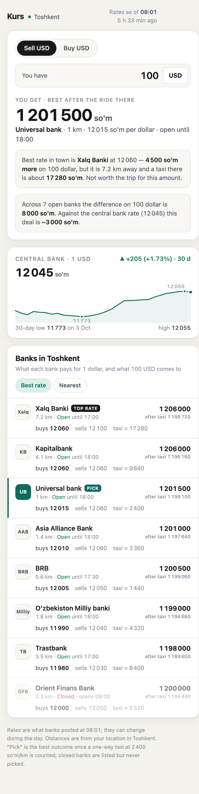
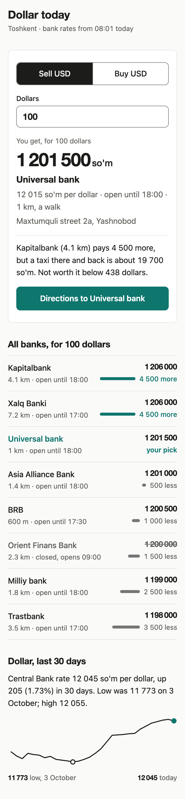
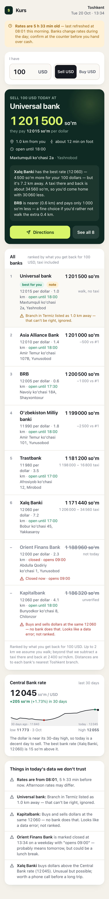
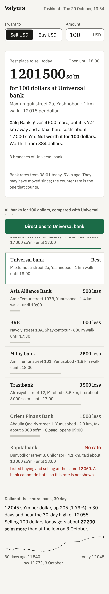

# Example: rates screen, with and without the skill

The vision test. Data is `tests/fixture-rates.json`, invented and seeded with traps (one bank best but far, one close and slightly worse, one bank buying and selling at the same rate, one branch 600 km away listed at 1 km, one closed bank, raw postal addresses, rates five hours old). Expected result is `tests/expected-rates.md`.

Two prompt variants, four runs, same model, same day. Nothing edited afterwards.

- **question-withheld/** (the canonical test): the prompt says only "build the home screen of a currency exchange app for Uzbekistan from this data". Finding the question is part of the test.
- **question-given/**: the prompt states the question ("I have 100 USD, where do I exchange it today?"). Run first; it showed that handing over the question hands over most of the vision. An earlier `_about` field in the fixture also described the traps, and the no-skill agent read it, so this variant is tainted on trap detection.

| Without skill, question withheld | With skill, question withheld |
|:---:|:---:|
|  |  |

| Without skill, question given | With skill, question given |
|:---:|:---:|
|  |  |

## Score, item by item

From `tests/expected-rates.md`. "Given" is the question-given variant, "Withheld" the canonical one.

| Item | No skill, given | Skill, given | No skill, withheld | Skill, withheld |
|---|---|---|---|---|
| Three sentences in the reply | no | yes | no | yes |
| Question found from the data | (given) | (given) | yes | yes |
| Answer object: amount, bank, distance, open until | yes | yes | yes | yes |
| Decision sentence with a threshold | trade-off, no threshold | yes, 384 | "not worth it", no threshold | yes, 438 |
| Comparison in the user's unit with bars, sorted | "−500 vs #1", no bars | yes | "after taxi" totals, no bars | yes |
| One action | two buttons | yes | none on screen | yes |
| Closed bank demoted | yes | yes | yes | yes |
| Impossible-spread bank never best or rival | excluded, flagged | excluded, "No rate" | listed second at full value | **used as the rival** |
| Wrong-distance branch flagged on screen | yes | yes | no | filtered out, not shown |
| "so'm" in sentences, "USD" in controls | yes | yes | yes | yes |
| Street-first addresses | partly | yes | raw, on expand | pick only |
| "Rates at 08:01" as a fact | yes, plus an amber banner | yes | yes | yes |
| What was removed or refused, in the reply | no | yes | no | yes |
| No horizontal overflow at 375px (document width) | yes | yes | **no, 455px** | yes |
| Verified by rendering, and said so | yes | yes | yes | yes |
| Page height at 375px, CSS px | 3 051 | 2 032 | 1 809 (overflowing) | 1 610 |

## What this shows

- **The base model finds the question on its own.** Both no-skill runs put the amount, the bank, and the distance first, and did the taxi arithmetic. The skill did not create that.
- **The skill changes what surrounds the answer.** The skill runs have one action, comparisons in words with bars, a stated threshold, a stated assumption, addresses rewritten, a removal list, and a shorter page. The no-skill runs have more boxes, more numbers per row, a banner, and in one case no action at all.
- **Data honesty is where both sides slip.** The no-skill withheld run listed the impossible rate at full value. The skill withheld run flagged it in the reply and then used it as the rival in the decision sentence, which is the exact move Q9 forbids. `vision.md` now says a rate that failed Q9 never serves as the answer or the rival.
- **The floor still matters.** The no-skill withheld page is 80px wider than the phone. The skill's verification step caught that class of defect in every skill run.
- **The fixture is too close to Kurs.** The with-skill agent said so itself: following `vision.md` on this data reproduces the example. A second fixture in an unrelated domain is owed before the vision claim is considered measured.

## Reproduce

See `tests/README.md`, implement test B.
